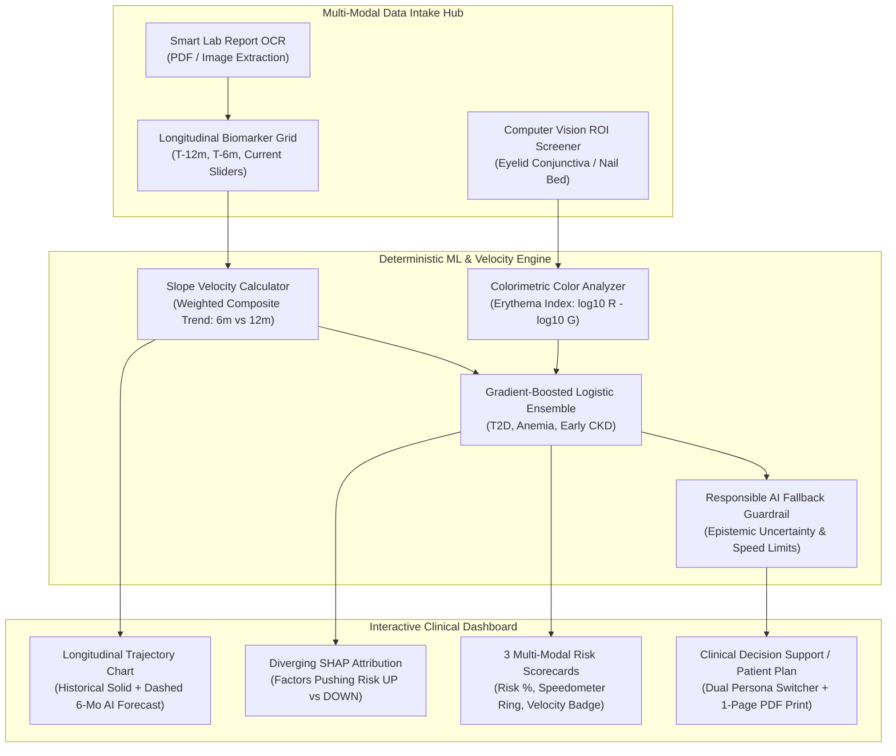

# ChronoPulse AI 🩺
### Multi-Modal Chronic Disease Risk & Longitudinal Lab Trend Profiler
> **Healthcare AI Hackathon &bull; Track: Early Disease-Risk Prediction**  
> *Clinical Decision Support (SaMD Class II Architecture) &bull; Multi-Modal Vision & Longitudinal Lab Trend Profiler*

---

## 🌟 Executive Summary & Clinical Mission
Chronic conditions such as **Type 2 Diabetes (T2D)**, **Subclinical Iron-Deficiency Anemia (IDA)**, and **Early Chronic Kidney Disease (CKD)** develop insidiously over months and years. Conventional laboratory assessments often examine single cross-sectional snapshots in time, ignoring the **rate of change (slope velocity $\Delta v = \frac{\Delta x}{\Delta t}$)** and missing the earliest windows for disease prevention.

**ChronoPulse AI** redefines preventive screening by combining:
1. **Longitudinal Lab Trend Profiling:** Tracking biomarker velocity over a 12-month trajectory (`T-12M`, `T-6M`, `Current`) to detect micro-accelerations before clinical thresholds are breached.
2. **Non-Invasive Computer Vision Biomarker Proxy:** Analyzing palpebral conjunctiva / nail bed images via real-time Region of Interest (ROI) colorimetry (Erythema Index & Pallor Scoring) to augment hematologic screening.
3. **Responsible AI Guardrails:** Automated uncertainty estimation and fallback routing if confidence drops below 75% or progression velocity exceeds safe bounds.
4. **Dual-Persona Explainability (SHAP):** Providing mathematical SHAP feature attribution and ICD-10 triage pathways for clinicians, while translating the exact same findings into plain-language health literacy micro-actions for patients.

---

## 🏗️ Architecture & Technology Stack



- **Frontend:** HTML5, Tailwind CSS (via CDN), Vanilla JavaScript, Chart.js (via CDN), Lucide Icons.
- **Backend Blueprint (`app.py`):** Python Flask REST API with CORS support, serving static assets and endpoints for OCR parsing, risk calculation, and computer vision colorimetry.
- **Client-Side Autonomy:** Fully self-contained — every preset, slider, chart, canvas ROI, and calculation functions in real-time in any browser without mandatory backend dependencies.

---

## ⚡ Key Modules & Features

### 1. Top Navigation & Responsible AI Guardrail Bar
- **Demo Patient Presets (Crucial for Live Demos):**
  - **Patient A (Pre-Diabetic + Early Renal Stress):** Fast-creeping HbA1c (5.6% $\to$ 6.0% $\to$ 6.3%), elevated fasting glucose (122 mg/dL), and softening eGFR (96 $\to$ 68 mL/min).
  - **Patient B (Subclinical Iron-Deficiency Anemia):** Dropping Hemoglobin (12.8 $\to$ 11.4 $\to$ 10.2 g/dL), depleted Ferritin (11 ng/mL), and elevated conjunctival pallor score (72%).
  - **Patient C (Healthy Baseline):** Stable biomarkers within optimal reference intervals.
- **PII De-Identification Shield:** Toggles HIPAA Safe-Harbor sanitization (`Token #CP-8841`) to protect patient privacy during clinical triage or multidisciplinary team reviews.
- **Dual-Persona View Switcher:**
  - **Clinician View:** Shows exact SHAP $\phi$ values, biomarker velocities, ICD-10 diagnostic codes (`R73.03`, `D50.9`, `N18.2`), and structured triage notes.
  - **Patient View:** Translates clinical data into plain-language health summaries, 3 daily lifestyle micro-actions, and 3 prepared questions for their physician.

### 2. Multi-Modal Data Intake Hub
- **Module A: Smart Lab Report OCR Intake:** Drag-and-drop zone with animated scanning laser effect and one-click demo loaders for Quest Diagnostics and LabCorp panels.
- **Module B: Editable Longitudinal Biomarker Table & Sliders:** Interactive inputs across 3 historical time points (`T-12 Months`, `T-6 Months`, `Current`) covering Glycemic, Hematologic, Renal, and Metabolic markers with real-time velocity slopes.
- **Module C: Non-Invasive Computer Vision Anemia Screener:**
  - Interactive HTML5 `<canvas>` with a draggable Region of Interest (ROI) bounding box.
  - Pixel sampling engine that calculates Erythema Index $EI = \log_{10}(R) - \log_{10}(G)$, Red/Green ratio, and normalized Pallor Score ($0-100\%$).
  - Directly feeds the vision score into the Anemia risk model.

### 3. Center Column: 6–12 Month Risk Prediction & Longitudinal Trajectory
- **3 Disease Risk Scorecards:** Circular progress gauges displaying probability, velocity metrics (e.g. `+0.12% HbA1c/mo`), model confidence, and automated fallback banners.
- **Longitudinal Trend & 6-Month AI Forecast Chart:**
  - Solid curves for historical visits (`T-12M`, `T-6M`, `Current`).
  - Animated dashed line for the **6-Month Projected Trajectory**.
  - Horizontal clinical reference threshold line (e.g. ADA 6.5% diabetic cutoff, KDIGO eGFR 60 cutoff, WHO 12.0 g/dL anemia cutoff).

### 4. Right Column: Explainable AI (SHAP) & Clinical Action Plan
- **SHAP Feature Importance / Diverging Bar Chart:** Visualizes exact factors pushing risk **UP** (Red) vs. **DOWN** (Emerald).
- **Clinical Decision Support & Patient Action Box:** Evidence-based guidance based on active persona and highest risk score.
- **1-Page Print / Export Triage Summary:** Clean `@media print` stylesheet formatted for clinic or hospital export.

---

## 🚀 Quickstart & Setup Instructions

### Option 1: Standalone Browser Preview (Zero Installation)
Simply double-click `index.html` or open it in any modern browser (Chrome, Edge, Firefox, Safari).  
All ML simulations, charts, presets, and computer vision canvas tools operate client-side.

### Option 2: Python Flask Server Run
To run the security-hardened backend blueprint with REST API endpoints:

```bash
# 1. Install dependencies
pip install -r requirements.txt

# 2. (Optional) Configure environment variables
cp .env.example .env

# 3. Launch the backend server
python app.py
```

Open your browser to:
```
http://127.0.0.1:5000
```

---

## 📡 RESTful API Reference (`app.py`)

### 1. `POST /api/parse-ocr`
Extracts structured biomarker entities and reference intervals from uploaded PDF/image lab reports.
- **Payload:** Multipart form file or JSON `{"panel_type": "cmp_cbc"}`
- **Response:**
  ```json
  {
    "status": "success",
    "confidence_score": 0.984,
    "extracted_biomarkers": {
      "hba1c": {"value": 6.3, "unit": "%", "ref_interval": "< 5.7%", "flag": "HIGH"},
      "glucose": {"value": 122, "unit": "mg/dL", "ref_interval": "70-99", "flag": "HIGH"}
    }
  }
  ```

### 2. `POST /api/predict-risk`
Calculates 6–12 month disease progression risks, slope velocities, and SHAP feature drivers.
- **Payload:**
  ```json
  {
    "biomarkers": {
      "hba1c": {"t12": 5.6, "t6": 6.0, "current": 6.3},
      "glucose": {"t12": 94, "t6": 108, "current": 122}
    },
    "vision_pallor_score": 68.0
  }
  ```
- **Response:**
  ```json
  {
    "status": "success",
    "responsible_ai": {
      "fallback_triggered": true,
      "advisory": "High velocity trajectory detected. Autonomous confidence suppressed."
    },
    "risks": {
      "t2d": {
        "probability": 62,
        "velocity": "+0.12% HbA1c/mo",
        "confidence": 92,
        "shap_drivers": [
          {"feature": "HbA1c Slope Velocity", "impact": 22, "direction": "UP"}
        ]
      }
    }
  }
  ```

### 3. `POST /api/vision-pallor`
Performs colorimetric erythema/pallor analysis on eyelid conjunctiva or nail bed image ROI.
- **Payload:**
  ```json
  {
    "roi": {"x": 90, "y": 110, "w": 75, "h": 45},
    "sample_type": "pale"
  }
  ```
- **Response:**
  ```json
  {
    "colorimetry": {
      "erythema_index": 0.071,
      "red_green_ratio": 1.18,
      "pallor_score": 72,
      "interpretation": "Marked Conjunctival Pallor (Anemia Risk Factor)"
    }
  }
  ```

---

## ⚖️ Regulatory & Safety Guardrails
- **Class II SaMD Decision Support Mode:** Implements guardrails aligned with FDA SaMD guidelines and ISO-14971 medical risk management.
- **Epistemic Uncertainty Fallback:** Automatically alerts clinicians when predictions hover near critical decision boundaries (45–65%) or when longitudinal velocities exceed two standard deviations of normal physiological drift.
- **HIPAA Safe Harbor Compliance:** Built-in de-identification engine strips 18 direct identifiers and generates pseudonymized session tokens (`#CP-8841`).
