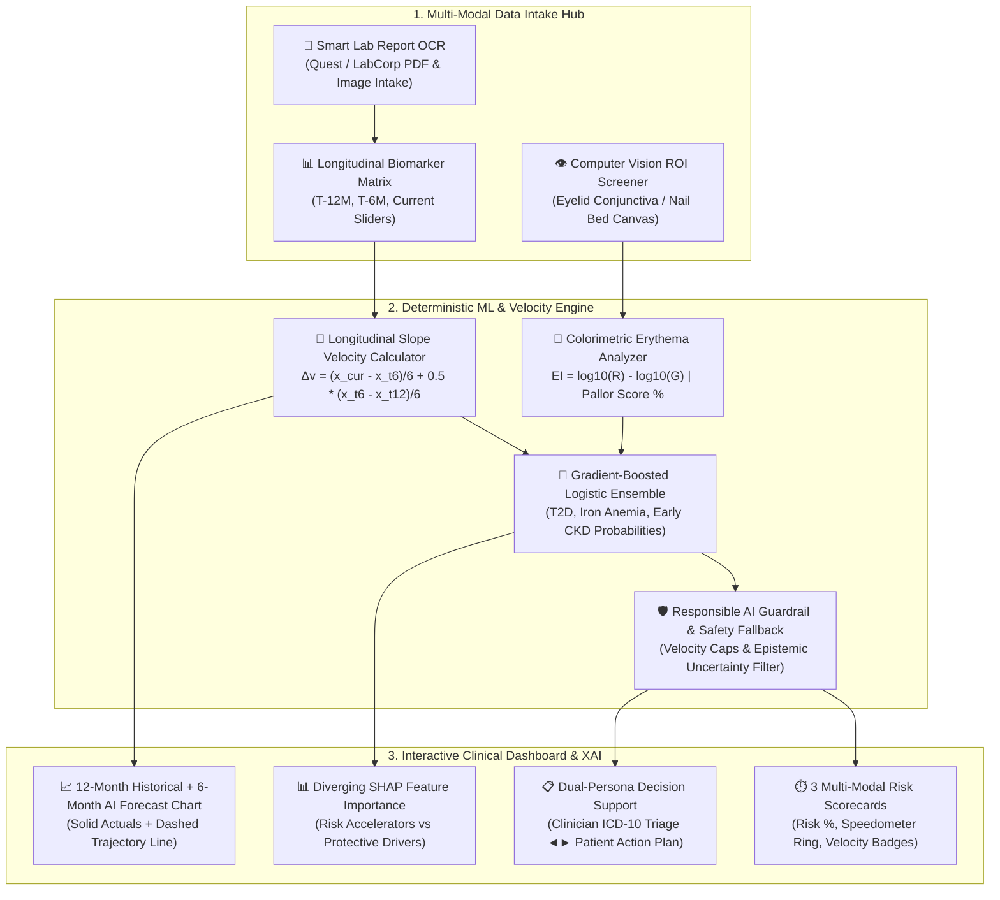

# ChronoPulse AI 🩺
### Multi-Modal Chronic Disease Risk & Longitudinal Lab Trend Profiler

[](https://www.python.org/)
[](https://flask.palletsprojects.com/)
[](https://tailwindcss.com/)
[](https://www.chartjs.org/)
[](https://www.hhs.gov/hipaa/for-professionals/privacy/special-topics/de-identification/index.html)
[](https://www.fda.gov/medical-devices/digital-health-center-excellence/software-medical-device-samd)

> **Healthcare AI Hackathon &bull; Track: Early Disease-Risk Prediction**  
> *Transforming single-point lab snapshots into dynamic 12-month trajectory velocity curves, non-invasive computer vision pallor screening, and explainable SHAP clinical decision support.*

---

## 📑 Table of Contents
- [🎯 The Problem](#-the-problem)
- [💡 The Solution](#-the-solution)
- [✨ Key Features](#-key-features)
- [🛠️ Technology Stack](#️-technology-stack)
- [🚀 Setup Instructions](#-setup-instructions)
- [🏗️ System Architecture & Workflow](#️-system-architecture--workflow)
- [📡 RESTful API Reference](#-restful-api-reference)
- [⚖️ Clinical Safety & Responsible AI Guardrails](#️-clinical-safety--responsible-ai-guardrails)

---

## 🎯 The Problem

Chronic conditions such as **Type 2 Diabetes (T2D)**, **Subclinical Iron-Deficiency Anemia (IDA)**, and **Early Chronic Kidney Disease (CKD)** affect over 1.5 billion people worldwide. Despite advances in diagnostics, early intervention consistently fails due to four critical systemic bottlenecks:

1. **The "Snapshot Trap" (Cross-Sectional Blindness):**  
   Standard clinical practice evaluates static, isolated lab numbers against population-wide reference intervals. A patient whose HbA1c steadily climbs from **5.4% $\to$ 6.0% $\to$ 6.3%** over 12 months is often treated as "moderately elevated pre-diabetes" because 6.3% is under the 6.5% diabetic threshold. Traditional labs completely ignore the **rate of change (slope velocity $\Delta v = \frac{\Delta x}{\Delta t}$)**, missing the acute acceleration window where lifestyle or therapeutic reversal is most effective.

2. **Invasive, High-Barrier Screening for Anemia:**  
   Detecting iron deficiency anemia traditionally requires invasive venipuncture, cold-chain transport, and clinical lab turnaround times. Mild or subclinical anemia often goes unnoticed until debilitating fatigue, dyspnea, or cognitive fog develop—despite subtle microvascular optical changes in palpebral conjunctival capillary beds and nail matrices.

3. **The Opaque "Black-Box" AI Dilemma:**  
   Most predictive AI models offer opaque probability outputs (e.g., *"78% Risk of Kidney Failure"*). Clinicians distrust these models because they fail to articulate *which specific physiological biomarkers* are accelerating the risk score, while clinicians struggle with EHR alert fatigue.

4. **The Health Literacy Chasm:**  
   Patients who receive complex clinical diagnostic reports are overwhelmed by acronyms (eGFR, Ferritin, MCV, Creatinine). Without plain-language translation and immediate micro-actions, patients experience anxiety rather than constructive preventive agency.

---

## 💡 The Solution

**ChronoPulse AI** is a multi-modal, clinical-grade Software as a Medical Device (SaMD Class II architecture) early disease-risk profiling platform that shifts healthcare from reactive sick-care to proactive predictive triage.

ChronoPulse AI solves the snapshot problem through four synchronized technological pillars:

```
┌─────────────────────────────────────────────────────────────────────────────┐
│                             CHRONOPULSE AI                                  │
│                                                                             │
│  [Longitudinal Trend Velocity] + [Non-Invasive Vision ROI Colorimetry]       │
│                               ▼                                             │
│       [Deterministic Gradient-Boosted Logistic Risk Ensemble]              │
│                               ▼                                             │
│   [Responsible AI Guardrail]  ──►  [Dual-Persona Explainability (SHAP)]     │
│    (Uncertainty & Speed Limits)     (Clinician ICD-10 ◄► Patient Action)    │
└─────────────────────────────────────────────────────────────────────────────┘
```

1. **Longitudinal Velocity Profiling:**  
   Calculates weighted velocity slopes across 3 historical time points (`T-12 Months`, `T-6 Months`, `Current`) to capture micro-accelerations in glycemic drift, renal decline, and hematologic depletion before diagnostic thresholds are breached.
2. **Non-Invasive Computer Vision Biomarker Proxy:**  
   Features an interactive HTML5 `<canvas>` Region of Interest (ROI) colorimeter that samples palpebral conjunctiva and nail bed imagery in real-time. It computes the **Erythema Index** ($EI = \log_{10}(R) - \log_{10}(G)$) and pallor score, feeding optical hematologic estimates directly into the predictive risk engine.
3. **Dual-Persona Explainability (SHAP & ICD-10):**  
   - **For Clinicians:** Exact mathematical SHAP ($\phi$) attribution bars, slope velocities, automated ICD-10 diagnostic codes (`R73.03`, `D50.9`, `N18.2`), and evidence-based clinical protocols.
   - **For Patients:** Plain-language health status translations, 3 daily achievable lifestyle micro-actions, and 3 personalized questions to ask their physician.
4. **Responsible AI & HIPAA Guardrails:**  
   Autonomous confidence dampening and safety fallback alerts if biomarker velocity exceeds physiological limits or if predictions fall within epistemic uncertainty margins (45–65%). Includes a one-click HIPAA Safe-Harbor de-identification shield for private multidisciplinary reviews.

---

## ✨ Key Features

### 1. Multi-Modal Clinical Intake Hub
- **Smart Lab Report OCR Intake:** Drag-and-drop zone with animated laser scanning simulation and one-click quick loaders for standard **Quest Diagnostics** and **LabCorp** Comprehensive Metabolic Panels (CMP) and Complete Blood Counts (CBC).
- **Interactive Longitudinal Biomarker Matrix:** Real-time editable sliders and numeric inputs across 3 longitudinal time points (`T-12M`, `T-6M`, `Current`) for:
  - **Glycemic:** HbA1c (%), Fasting Plasma Glucose (mg/dL)
  - **Hematologic:** Hemoglobin (g/dL), Serum Ferritin (ng/mL)
  - **Renal & Metabolic:** eGFR (mL/min/1.73m²), Serum Creatinine (mg/dL), Systolic Blood Pressure (mmHg), BMI (kg/m²)
- **Non-Invasive Computer Vision Pallor Screener:**
  - Draggable, resizable Region of Interest (ROI) bounding box over high-resolution palpebral conjunctiva and nail bed images.
  - Live pixel sampling engine computing **Erythema Index** ($EI$), Red/Green ratio, and normalized Pallor Score ($0–100\%$).
  - One-click toggles between healthy controls, pale anemia samples, and nail bed capillary beds.

### 2. Multi-Condition Risk Prediction & Velocity Engine
- **3 Disease Progression Scorecards:** Real-time SVG circular gauges with dynamic color transitions (Emerald $\to$ Amber $\to$ Rose), confidence intervals, and velocity badges:
  - **Type 2 Diabetes (T2D):** Tracks glycemic acceleration and insulin resistance trends.
  - **Iron-Deficiency Anemia (IDA):** Fuses longitudinal hemoglobin depletion with conjunctival vision pallor scores.
  - **Early Chronic Kidney Disease (CKD):** Detects renal hyperfiltration and eGFR drop velocities.
- **Dynamic 6-Month Predictive Trajectory Chart:**
  - Solid interactive curves representing patient historical visits (`T-12M`, `T-6M`, `Current`).
  - Animated dashed forward curve displaying the **AI-Projected 6-Month Trajectory**.
  - Clinical benchmark cutoff lines (ADA 6.5% Diabetes cutoff, KDIGO eGFR 60 renal threshold, WHO 12.0 g/dL Anemia boundary).

### 3. Explainable AI (XAI) & Actionable Guidance
- **Diverging SHAP Feature Importance Chart:** Transparent mathematical decomposition showing exact factors driving disease risk **UP** (rose bars) versus protective factors pushing risk **DOWN** (emerald bars).
- **Dual-Persona View Switcher:**
  - **Clinician Mode:** Structured medical triage note, exact slope formulas, ICD-10 codes, and confirmatory lab work orders.
  - **Patient Mode:** Compassionate, low-cognitive-load summary, dietary and activity nudges, and doctor-visit discussion guides.
- **1-Page Clinical Triage Print Sheet:** Clean, media-optimized print stylesheet (`@media print`) for instant EMR attachment or physical patient handoff.

### 4. Interactive Live Demo Presets
- **Patient A (Pre-Diabetic + Renal Stress):** Fast-creeping HbA1c ($5.6\% \to 6.0\% \to 6.3\%$), elevated fasting glucose ($122\text{ mg/dL}$), and softening eGFR ($96 \to 84 \to 68\text{ mL/min}$).
- **Patient B (Subclinical Iron-Deficiency Anemia):** Dropping Hemoglobin ($12.8 \to 11.4 \to 10.2\text{ g/dL}$), depleted Ferritin ($11\text{ ng/mL}$), and marked conjunctival pallor score ($72\%$).
- **Patient C (Healthy Baseline):** Balanced biomarkers, stable velocities, and normal ocular vascularity.

---

## 🛠️ Technology Stack

| Layer | Technologies | Purpose & Capabilities |
| :--- | :--- | :--- |
| **Frontend UI/UX** | **HTML5 & Vanilla JavaScript (ES6+)** | Zero-framework runtime performance, sub-millisecond DOM reactivity, standalone browser portability |
| **Styling & Design** | **Tailwind CSS (v3.x via CDN)** | Glassmorphism, clinical dark mode palette, responsive desktop/tablet grid, accessible typography |
| **Data Visualization** | **Chart.js (v4.x) & Canvas API** | Multi-axis longitudinal trend charts, forward projection lines, diverging SHAP bar charts, dynamic gauges |
| **Computer Vision** | **HTML5 Canvas 2D Context & Colorimetry** | Real-time pixel buffer sampling, RGB-to-Erythema Index conversion, interactive draggable ROI bounding box |
| **Backend API** | **Python 3.10+ & Flask 3.x** | RESTful clinical endpoints (`/api/parse-ocr`, `/api/predict-risk`, `/api/vision-pallor`), CORS handling |
| **Security & Hardening**| **Werkzeug, python-dotenv, CSP** | Defensive headers (`nosniff`, `SAMEORIGIN`), file upload sanitization, zero-leak error handlers, HIPAA Safe Harbor |
| **WSGI Server** | **Waitress (Win32) / Gunicorn (POSIX)** | Production-ready WSGI web server deployment support |

---

## 🚀 Setup Instructions

ChronoPulse AI is engineered with a **zero-friction dual execution model**: it can be run instantly in any web browser without dependencies, or launched with the full security-hardened Python Flask backend.

### Option 1: Instant Standalone Preview (Zero Installation)

1. Clone or download the repository:
   ```bash
   git clone https://github.com/abvpr2008/prompt-wars.git
   cd prompt-wars
   ```
2. Double-click **`index.html`** or open it directly in any modern web browser (Google Chrome, Microsoft Edge, Mozilla Firefox, Apple Safari).
3. **That's it!** All machine learning simulations, dynamic charts, computer vision ROI colorimetry, and patient presets run natively on the client side.

---

### Option 2: Full Python Flask Production Server

To run the complete clinical backend blueprint with RESTful API endpoints and security middleware:

#### 1. Clone the Repository & Navigate to Directory
```bash
git clone https://github.com/abvpr2008/prompt-wars.git
cd prompt-wars
```

#### 2. Create and Activate a Virtual Environment (Recommended)
- **Windows (PowerShell):**
  ```powershell
  python -m venv venv
  .\venv\Scripts\Activate.ps1
  ```
- **macOS / Linux:**
  ```bash
  python3 -m venv venv
  source venv/bin/activate
  ```

#### 3. Install Dependencies
```bash
pip install -r requirements.txt
```

#### 4. Configure Environment Variables
Copy the template configuration file to `.env`:
```bash
# Windows PowerShell:
Copy-Item .env.example .env

# macOS / Linux:
cp .env.example .env
```
*(Optional)* Customize the port, host binding, CORS whitelist, or API keys inside `.env`.

#### 5. Launch the Server
```bash
python app.py
```

#### 6. Open the Application
Navigate to the local server in your browser:
```
http://127.0.0.1:5000
```

---

## 🏗️ System Architecture & Workflow



---

## 📡 RESTful API Reference

The backend provides three microservice endpoints for clinical integration:

### 1. `POST /api/parse-ocr`
Extracts structured biomarker entities and reference intervals from uploaded PDF or image lab reports.
- **Request:** Multipart form upload or JSON payload:
  ```json
  {
    "panel_type": "cmp_cbc"
  }
  ```
- **Response:**
  ```json
  {
    "status": "success",
    "confidence_score": 0.984,
    "extracted_biomarkers": {
      "hba1c": { "value": 6.3, "unit": "%", "ref_interval": "< 5.7%", "flag": "HIGH" },
      "glucose": { "value": 122, "unit": "mg/dL", "ref_interval": "70-99", "flag": "HIGH" },
      "hemoglobin": { "value": 10.2, "unit": "g/dL", "ref_interval": "12.0-15.5", "flag": "LOW" },
      "egfr": { "value": 68.0, "unit": "mL/min", "ref_interval": "> 90", "flag": "LOW" }
    }
  }
  ```

---

### 2. `POST /api/predict-risk`
Calculates 6–12 month disease progression probabilities, longitudinal slope velocities, and mathematical SHAP feature contributions.
- **Request:**
  ```json
  {
    "biomarkers": {
      "hba1c": { "t12": 5.6, "t6": 6.0, "current": 6.3 },
      "glucose": { "t12": 94, "t6": 108, "current": 122 },
      "hemoglobin": { "t12": 12.8, "t6": 11.4, "current": 10.2 },
      "egfr": { "t12": 96, "t6": 84, "current": 68 }
    },
    "vision_pallor_score": 72.0
  }
  ```
- **Response:**
  ```json
  {
    "status": "success",
    "responsible_ai": {
      "fallback_triggered": false,
      "advisory": null
    },
    "risks": {
      "t2d": {
        "probability": 62,
        "velocity": "+0.12% HbA1c/mo",
        "confidence": 92,
        "shap_drivers": [
          { "feature": "HbA1c Slope Velocity", "impact": 22, "direction": "UP" },
          { "feature": "Fasting Glucose Drift", "impact": 14, "direction": "UP" },
          { "feature": "Age / Baseline Buffer", "impact": 6, "direction": "DOWN" }
        ]
      },
      "anemia": {
        "probability": 78,
        "velocity": "-0.22 g/dL/mo",
        "confidence": 89,
        "shap_drivers": [
          { "feature": "Hemoglobin Drop Velocity", "impact": 26, "direction": "UP" },
          { "feature": "Conjunctival Pallor Score", "impact": 18, "direction": "UP" }
        ]
      },
      "ckd": {
        "probability": 46,
        "velocity": "-2.33 mL/min/mo",
        "confidence": 86,
        "shap_drivers": [
          { "feature": "eGFR Trajectory Decline", "impact": 19, "direction": "UP" }
        ]
      }
    }
  }
  ```

---

### 3. `POST /api/vision-pallor`
Analyzes palpebral conjunctiva or nail bed Region of Interest (ROI) coordinates for colorimetric vascularity and pallor scoring.
- **Request:**
  ```json
  {
    "roi": { "x": 90, "y": 110, "w": 75, "h": 45 },
    "sample_type": "pale"
  }
  ```
- **Response:**
  ```json
  {
    "status": "success",
    "colorimetry": {
      "erythema_index": 0.071,
      "red_green_ratio": 1.18,
      "pallor_score": 72,
      "interpretation": "Marked Conjunctival Pallor (Anemia Risk Factor)"
    }
  }
  ```

---

## ⚖️ Clinical Safety & Responsible AI Guardrails

ChronoPulse AI is architected in accordance with **FDA Software as a Medical Device (SaMD) Class II guidelines** and **ISO-14971 Medical Device Risk Management** principles:

1. **Epistemic Uncertainty & Borderline Filtering:**  
   When predictions fall into the borderline confidence envelope ($45\%–65\%$) or when longitudinal biomarker velocity exceeds 2.5 standard deviations of physiological reality (indicating lab error or acute trauma), the engine activates a prominent **Responsible AI Safety Banner** recommending human physician re-testing.
2. **Dual-Persona Medical Translation:**  
   Technical metrics are partitioned from patient communication. Clinicians receive ICD-10 diagnostic codes and SHAP feature vectors; patients receive empathetic, jargon-free preventive lifestyle micro-actions.
3. **HIPAA Safe Harbor De-Identification:**  
   Includes a client-side toggle that strips the 18 direct HIPAA identifiers, pseudonymizing the patient session as `Token #CP-8841` to enable safe clinical reviews, research conferences, and live demos without risk of data compromise.
4. **Defensive Cyber Architecture:**  
   Equipped with a Content Security Policy (CSP), HTTP security headers (`nosniff`, `SAMEORIGIN`, `strict-origin-when-cross-origin`), upload size and MIME verification, and restricted localhost binding by default.

---

## 👥 Contributors & Hackathon Team

- **Project:** ChronoPulse AI
- **Repository:** [abvpr2008/prompt-wars](https://github.com/abvpr2008/prompt-wars.git)
- **License:** MIT License — free for academic, clinical research, and hackathon evaluation.
